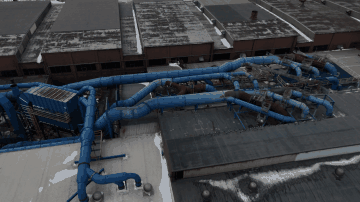
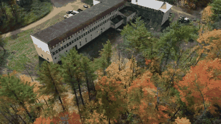
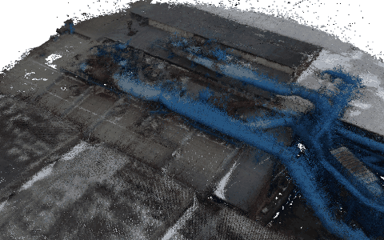
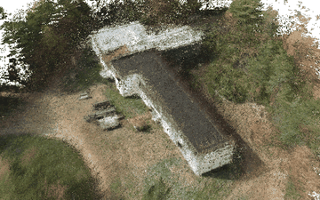
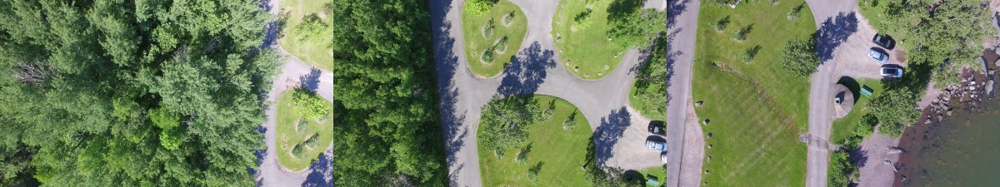
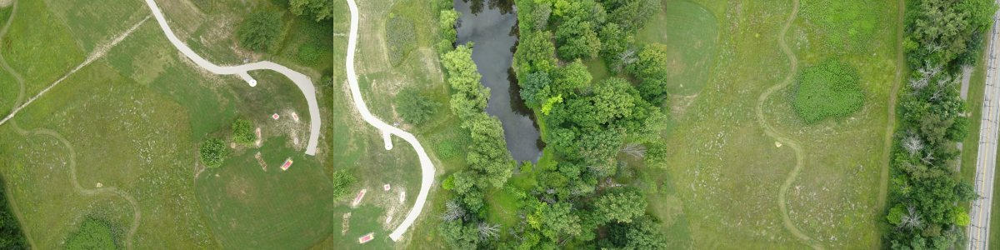
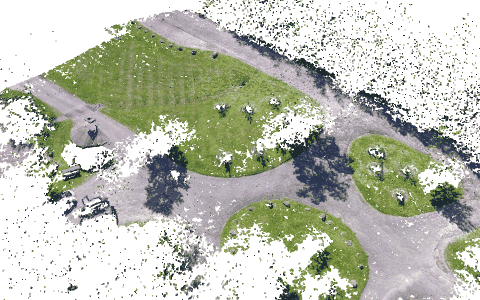
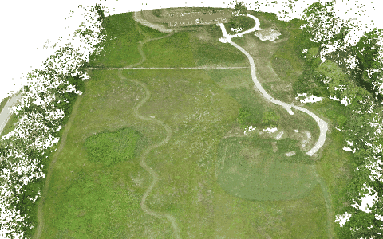

# 3D Reconstruction from Drone Footage

**Goal:** Implement the dense 3D scene reconstruction pipeline using aerial imagery. Start from classical (SfM) then try modern pipelines (3DGS) and compare them on the same scenes.

- **Classical:** Structure-from-Motion with plane sweep multi-view stereo: SO(3), epipolar geometry,
RANSAC, triangulation, bundle adjustment, PnP, incremental mapping, plane sweep, and depth
fusion.
- **Modern:** Use off-the-shelf learned pose estimators and the `gsplat` library,
putting effort into downstream challenges: appearance changes, pose refinement,
scale, and 8 GB of VRAM.

## Results

### Stock Drone Footage

Orbital drone footage was found on Vimeo and downloaded at 1440p.

| [Roof](https://vimeo.com/1153105848) | [Warehouse](https://vimeo.com/481823336) |
|---|---|
|  |  |
|  |  |

| Metric | Roof | Warehouse |
|---|---|---|
| input | 145 sec, 2560×1440, 60 fps | 137 sec, 2560×1440, 60 fps |
| keyframes | 165, one per 0.87 s | 156, one per 0.85 s |
| orbit coverage, camera pitch | 1.3 laps (471°), 45° down | 3.0 laps (1096°), 42° down |
| SfM registered | 165 / 165 | 156 / 156 |
| sparse points, mean track length | 138k, 10.0 | 55k, 6.7 |
| mean reprojection error | 0.56 px | 0.72 px |
| MVS valid depth per view (mean) | 88 % | 72 % |
| Poisson mesh, octree depth 10 | 1.4M vertices, 2.7M triangles | 2.9M vertices, 5.9M triangles |

No ground truth for either video (no GPS/LiDAR), so metrics primarily measure 
consistency instead of accuracy.

### Aerial Imagery

| Brighton Beach (ODM, 18 photos) | Aukerman (ODM, 77 photos) |
|---|---|
|  |  |
|  |  |

| Metric | Brighton Beach | Aukerman |
|---|---|---|
| input | 18 DJI photos, 4000×2250, GPS | 77 Sony photos, 4896×3672, GPS |
| SfM registered | 18 / 18 | 76 / 77 |
| sparse points, mean track length | 9.4k, 2.8 | 46k, 3.6 |
| reprojection error (RMSE) | 0.87 px | 1.28 px |
| camera position error vs COLMAP | 3.4 cm | 31 cm |
| GPS error after georeferencing (COLMAP) | 0.42 m (0.43 m) | 1.10 m (1.13 m) |
| MVS valid depth per view (mean) | 66 % | 80 % |
| agreement with ODM's cloud (F-score @ 20 cm) | 0.61 | — |

We use COLMAP as the reference for camera poses. GPS error matches COLMAP's model, F-score is computed against OpenDroneMap's point cloud for agreement. 

## Milestones

| # | Milestone | You implement | Gate |
|---|-----------|---------------|------|
| M0 | Bringup, conventions | — | COLMAP reference of Brighton Beach viewed in 3D |
| M1 | Camera geometry & SO(3) | `geometry/rotations.py`, `geometry/camera.py` | `-k m01` |
| M2 | Video → keyframes | `video/frames.py` | `-k m02` + a real video |
| M3 | Features, matching, RANSAC, H | `sfm/features.py`, `geometry/{ransac,homography}.py` | `-k m03` |
| M4 | Two-view geometry | `geometry/{epipolar,triangulation}.py` | `-k m04` |
| M5 | Bundle adjustment | `sfm/bundle_adjustment.py` | `-k m05` |
| M6 | Incremental SfM | `geometry/pnp.py`, `sfm/{tracks,incremental}.py` | `-k m06` + 18/18 on Brighton Beach |
| M7 | Georeferencing & pose metrics | `geometry/alignment.py`, `geo/geodesy.py`, `eval/poses.py` | `-k m07` + GPS-aligned model |
| M8 | Plane-sweep MVS | `mvs/plane_sweep.py` (stretch: `mvs/patchmatch.py`) | `-k m08` |
| M9 | Fusion & geometry metrics | `mvs/fusion.py`, `eval/geometry.py` | `-k m09` + mesh of Aukerman |
| M10 | Learned poses | run VGGT / MASt3R-SfM / GLOMAP | pose-accuracy table |
| M11 | 3DGS on drone data | `modern/splat.py` | held-out PSNR/LPIPS |
| M12 | Geometry from splats | depth render → fusion / 2DGS | F-score vs MVS |
| M13 | Comparison study | configs + write-up | [docs/study.md](docs/study.md) |

### How to work one

1. Read the milestone in [docs/roadmap.md](docs/roadmap.md) and its reading in
   [docs/theory.md](docs/theory.md).
2. Open the stub modules listed for it. Each docstring states the contract, the math, and
   the traps.
3. `uv run pytest tests/student -k m03 -x` until it is green. The tests use synthetic
   scenes with exact ground truth ([synthetic.py](src/aerial_recon/synthetic.py)).
4. Run the milestone's real-data gate, e.g. `aerial-recon sfm` → `aerial-recon compare-poses`
   against COLMAP.
5. Write down what surprised you. The study write-up is built from these notes.

## Layout

```
src/aerial_recon/
  types.py           Camera, Pose, Image, Point3D, Reconstruction   (scaffold)
  synthetic.py       drone trajectories, terrain, slab renderer, GT (scaffold)
  io/                COLMAP text I/O, PLY, EXIF GPS                  (scaffold)
  geometry/          rotations, camera, RANSAC, H, F/E, triangulation, PnP, Sim3  (M1-M7)
  video/frames.py    extraction (scaffold); sharpness, keyframes     (M2)
  sfm/               SIFT (scaffold), matching, tracks, BA, incremental, COLMAP ref
  geo/geodesy.py     WGS84 → ECEF → ENU                              (M7)
  geo/level.py       z-up levelling without GPS (video)
  mvs/               warp (scaffold), plane sweep, PatchMatch, fusion, meshing (scaffold)
  modern/            pose sources (scaffold), gsplat trainer         (M10-M11)
  eval/              pose, geometry, image metrics
tests/scaffold/      passes now
tests/student/       one file per milestone — your gates
docs/                roadmap, theory, datasets, conventions, study design, optimizations
```
